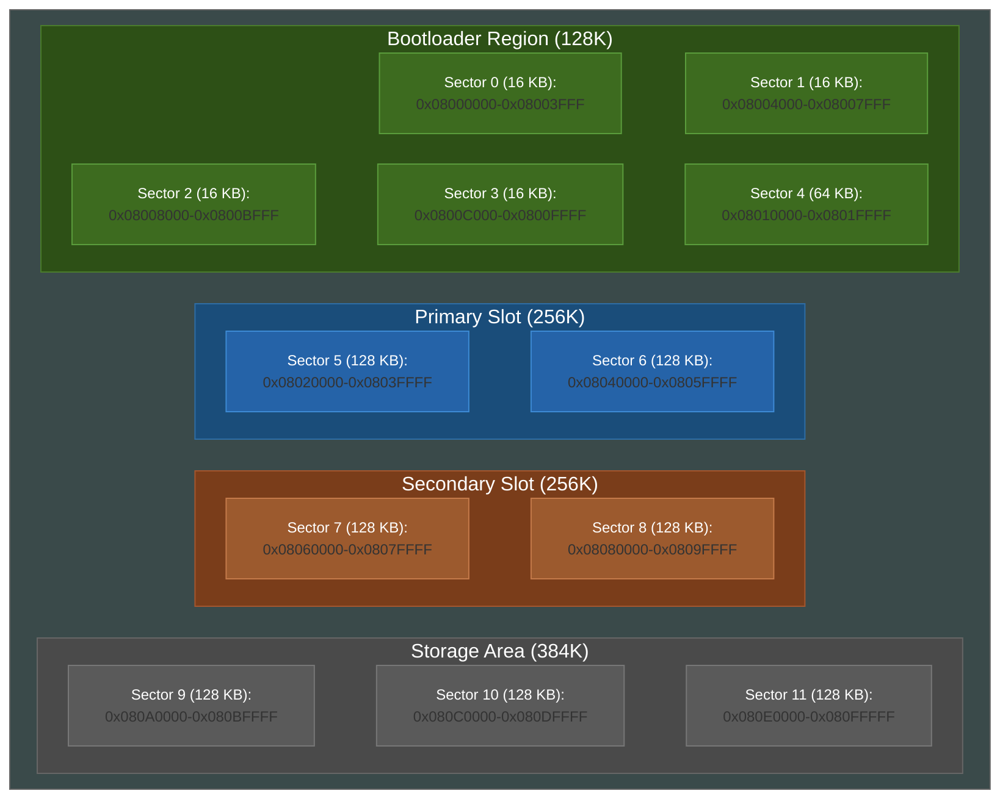

# Wicked Boot
[](https://forthebadge.com)

[](https://github.com/EvgeniyGA/wicked_boot/actions/workflows/build-all.yml)
[](https://github.com/EvgeniyGA/wicked_boot/actions/workflows/qemu-tests.yml)
[](https://github.com/EvgeniyGA/wicked_boot/releases)

[](https://github.com/EvgeniyGA/wicked_boot/blob/main/LICENSE)

Modern, lightweight bootloader for STM32 microcontrollers, based on [MCUboot](https://www.mcuboot.com/). Designed for secure updates and easy remote debugging.
This project incorporates configuration files and build scripts adapted from the official [STMicroelectronics stm32-mw-mcuboot](https://github.com/STMicroelectronics/stm32-mw-mcuboot) repository.

## ✨ Features
- [X] Simple boot
- [X] Remote debugging
- [X] USB-DFU support
- [X] WebUSB support

## 🚀 Quick Start
1. Clone the repository:
```bash
git clone --recursive https://github.com/EvgeniyGA/wicked_boot.git
cd wicked_boot
git submodule update --init --recursive
```
2. Build:
```bash
cmake --preset=stm32f4
cmake --build --preset=stm32f4
```
4. Flash the device. You can use any preferred flashing method compatible with your hardware setup (J-Link, ST-Link).
Target binary: build/stm32f4/wicked_boot.bin

## 🛠️ Hardware
Tested on: **STM32F407VGT6** (Waveshare Core407V)

## 📚 Documentation
For detailed MCUboot concepts, refer to the [official MCUboot design documentation](https://docs.mcuboot.com/design.html).

## 🗺️ STM32F407VG Flash Layout for MCUboot

